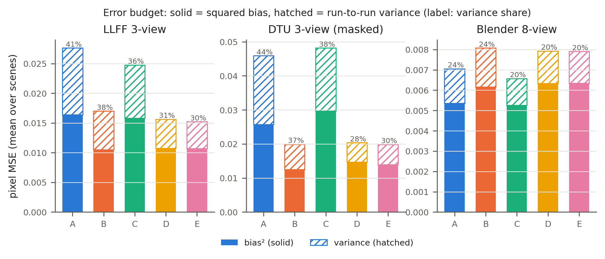
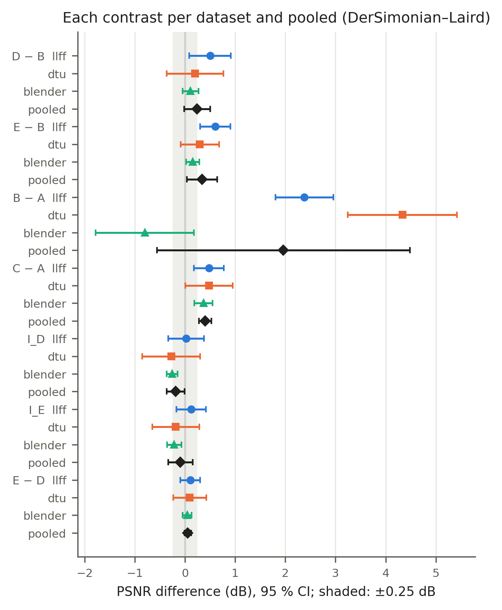

# Depth meets Dropout: are DNGaussian and DropGaussian complementary in sparse-view 3DGS?

A course research project (CSD361) by Aayush and Disha. We ask whether two sparse-view 3D Gaussian Splatting regularizers are **complementary, redundant or interfering**:

- **DNGaussian** (CVPR 2024) adds monocular-depth regularization. This repo is a fork of [Fictionarry/DNGaussian](https://github.com/Fictionarry/DNGaussian).
- **DropGaussian** (CVPR 2025) randomly drops Gaussians during training. We port it verbatim from [DCVL-3D/DropGaussian_release](https://github.com/DCVL-3D/DropGaussian_release).

Every variant is the same code with different flags. The 2×2 design plus a decoupled combination:

| ID | Depth | Dropout | Mask reaches the depth passes |
| --- | --- | --- | --- |
| A | – | – | – |
| B (DNGaussian) | ✓ | – | – |
| C (DropGaussian-style) | – | ✓ | – |
| D (naive combination) | ✓ | ✓ | yes |
| E (decoupled combination) | ✓ | ✓ | no |

The analysis rules were pre-registered before any results existed (tags `prereg-v1`…`v3`). The experiments ran only from tagged code (`v1.0-exp`, `v1.1-exp`, `v1.2-exp`), for 1,169 runs in total on one lab RTX A4000.

## Key results

PSNR (dB) on held-out views, mean over 3 seeds. Differences are paired by scene, with 95 % CIs.

| Variant | LLFF 3-view | DTU 3-view (masked) | Blender 8-view |
| --- | --- | --- | --- |
| A: none | 16.33 | 14.04 | 23.47 |
| B: depth (DNGaussian) | 18.71 | 18.37 | 22.66 |
| C: dropout | 16.80 | 14.51 | **23.83** |
| D: depth + dropout | 19.21 | 18.57 | 22.77 |
| E: depth + dropout, decoupled | **19.31** | **18.67** | 22.82 |

| Contrast | LLFF | DTU | Blender | Pooled |
| --- | --- | --- | --- | --- |
| E − B: adding dropout to DNGaussian | +0.60 [+0.30, +0.91] | +0.30 [−0.09, +0.68] | +0.15 [+0.02, +0.28] | **+0.34 [+0.04, +0.64]** |
| E − D: decoupling the depth passes | +0.10 | +0.09 | +0.04 | +0.05 (≈ 0) |
| I_D: interaction (D − C) − (B − A) | +0.02 | −0.28 | −0.26 | **−0.19 [−0.37, −0.01]** |

1. **Complementary where it matters most.** On very sparse forward-facing scenes (LLFF, 2–3 views), adding dropout to DNGaussian gains about +0.5 dB (D − B +0.45 at 2 views, +0.50 at 3; E − B +0.60 at 3), and the two gains add up about additively.
2. **Additive at best across datasets.** The pooled interaction is slightly negative. Where the depth prior itself stops helping (Blender at 8 views, LLFF at 9 views), the combination is partly redundant.
3. **Decoupling shows no measurable effect.** Shielding the depth passes from the dropout mask moves PSNR by under 0.25 dB in every point estimate; the CIs are inconclusive on LLFF and DTU and the effect is ≈ 0 on Blender and pooled.
4. **The mechanism is the error budget.** Depth reduces *bias* and dropout reduces *run-to-run variance*, in the sparsest settings. Neither removes the variance left above DNGaussian's bias floor, so the remaining headroom is variance.
5. **Two proposed explanations are not supported by the data.** Neither the compensation nor the opacity-cap explanation shows a detectable effect (§5.2.9 of the pre-registration); the contrasts are inconclusive, not shown to be zero.

| | |
| --- | --- |
|  |  |
| **F1** Error budget: bias² (solid) and variance (hatched) | **F3** Each contrast per dataset and pooled |

More figures:
- [F5 bias floor](results/v2/figures/fig_ceiling.png)
- [F2 budget vs views](results/v2/figures/fig_budget_views.png)
- [F9 compensation](results/v2/figures/fig_comp.png)
- [F8 depth dose](results/v2/figures/fig_depthdose.png)
- [F7 power](results/v2/figures/fig_power.png)
- [LLFF forest](results/figures/fig_forest.png)
- [views](results/figures/fig_views.png)
- [qualitative](results/figures/fig_qual.png)

Full write-ups:
- [results/RESULTS.md](results/RESULTS.md) (v1, LLFF)
- [results/v2/RESULTS_v2.md](results/v2/RESULTS_v2.md) (v2, all datasets)
- report sections in [docs/report/](docs/report/)

## Reproduce

**1. Environment.** Python 3.7, PyTorch 1.12.1, CUDA 11.3 (see `setup_env.sh`), or Colab with `notebooks/colab_runner.ipynb`. Build the vendored extensions in `submodules/`, `gridencoder/` and `shencoder/` for your GPU.

**2. Data,** each checked by md5:

| Archive | md5 |
| --- | --- |
| `llff_with_depth.tar` | `0f6bd7bdae837ec58ad757c7c00b0561` |
| `dtu_with_depth.tar` | `dc8df470e9cf6e46cd024cb34d19c175` |
| `blender_with_depth.tar` | `e7597085f8682b660699a39f63d5957f` |

The DPT depth is included in each archive, so never regenerate it.

**3. One run,** variant E on fern, seed 0:
```bash
python train_llff.py -s data/llff/fern --model_path output/E/fern -r 8 --eval --n_sparse 3 --rand_pcd \
  --depth_scale 1 --drop_rate 0.2 --depth_render clean --seed 0  # plus DNGaussian's LLFF flags, see scripts/run_llff.sh
```

**4. A whole block,** from a tag, sharded over GPUs. Always do a dry run first:
```bash
git checkout v1.2-exp
python experiments/run_matrix.py --matrix experiments/matrix_dtu.yaml --data_root data/dtu --out_root outputs_dtu --shard 0/3 --dry_run
```

**5. Tables, statistics and figures** from the committed per-run metrics, with no GPU needed. The commands are in [results/v2/RESULTS_v2.md](results/v2/RESULTS_v2.md#how-to-regenerate). Everything, including the error budget from the renders, runs on a Colab CPU with [`notebooks/results_v2_colab.ipynb`](notebooks/results_v2_colab.ipynb).

**6. Checks:** `bash scripts/check.sh` takes seconds and needs no GPU. `bash scripts/gpu_smoke.sh` takes 1.5–7 min.

## Repository map

| Path | What |
| --- | --- |
| `train_llff.py`, `train_dtu.py`, `train_blender.py` | Training, with dropout behind `--drop_rate`, `--depth_render`, `--drop_mode` |
| `gaussian_renderer/` | Renderers. Dropout is applied only inside training (AGENTS.md invariants) |
| `experiments/` | Runner, matrices, `aggregate.py`, `stats.py`, `bias_variance.py`, `extra_blocks.py`, plots |
| `results/` | Committed tables, figures and write-ups (v1 and v2) |
| `docs/` | Plans, the pre-registration (`PLAN_V2.md` §5) and report drafts |
| `notebooks/` | Colab runner and the results-v2 analysis notebook |

---

## Upstream DNGaussian README

### DNGaussian: Optimizing Sparse-View 3D Gaussian Radiance Fields with Global-Local Depth Normalization

This is the official repository for our CVPR 2024 paper **DNGaussian: Optimizing Sparse-View 3D Gaussian Radiance Fields with Global-Local Depth Normalization**.

[Paper](https://arxiv.org/abs/2403.06912) | [Project](https://fictionarry.github.io/DNGaussian/) | [Video](https://www.youtube.com/watch?v=WKXCFNJHZ4o)


### Installation

Tested on Ubuntu 18.04, CUDA 11.3, PyTorch 1.12.1

``````
conda env create --file environment.yml
conda activate dngaussian

cd submodules
git clone git@github.com:ashawkey/diff-gaussian-rasterization.git --recursive
git clone https://gitlab.inria.fr/bkerbl/simple-knn.git
pip install ./diff-gaussian-rasterization ./simple-knn
``````

If encountering installation problem of the `diff-gaussian-rasterization` or `gridencoder`, you may get some help from [gaussian-splatting](https://github.com/graphdeco-inria/gaussian-splatting) and [torch-ngp](https://github.com/ashawkey/torch-ngp).


### Evaluation

#### LLFF

1. Download LLFF from [the official download link](https://drive.google.com/file/d/11PhkBXZZNYTD2emdG1awALlhCnkq7aN-/view?usp=drive_link).

2. Generate monocular depths by DPT:

   ```bash
   cd dpt
   python get_depth_map_for_llff_dtu.py --root_path $<dataset_path_for_llff> --benchmark LLFF
   ```

3. Start training and testing:

   ```bash
   # for example
   bash scripts/run_llff.sh data/llff/fern output/llff/fern ${gpu_id}
   ```


#### DTU

1. Download DTU dataset

   - Download the DTU dataset "Rectified (123 GB)" from the [official website](https://roboimagedata.compute.dtu.dk/?page_id=36/), and extract it.
   - Download masks (used for evaluation only) from [this link](https://drive.google.com/drive/folders/1OEmJcbP0XUVfG647mdYWxEy9yOw7L_Si?usp=drive_link) (backed up from RegNeRF).


2. Organize DTU for few-shot setting

   ```bash
   bash scripts/organize_dtu_dataset.sh $rectified_path
   ```

3. Format

   - Poses: following [gaussian-splatting](https://github.com/graphdeco-inria/gaussian-splatting), run `convert.py` to get the poses and the undistorted images by COLMAP.
   - Render Path: following [LLFF](https://github.com/Fyusion/LLFF) to get the `poses_bounds.npy` from the COLMAP data. (Optional)


4. Generate monocular depths by DPT:

   ```bash
   cd dpt
   python get_depth_map_for_llff_dtu.py --root_path $<dataset_path_for_dtu> --benchmark DTU
   ```

5. Set the mask path and the expected output model path in `copy_mask_dtu.sh` for evaluation. (default: "data/dtu/submission_data/idrmasks" and "output/dtu") 

6. Start training and testing:

   ```bash
   # for example
   bash scripts/run_dtu.sh data/dtu/scan8 output/dtu/scan8 ${gpu_id}
   ```


#### Blender

1. Download the NeRF Synthetic dataset from [here](https://drive.google.com/file/d/1OsiBs2udl32-1CqTXCitmov4NQCYdA9g/view?usp=drive_link).

2. Generate monocular depths by DPT:

   ```bash
   cd dpt
   python get_depth_map_for_blender.py --root_path $<dataset_path_for_blender>
   ```

3. Start training and testing:

   ```bash
   # for example
   # there are some special settings for different scenes in the Blender dataset, please refer to "run_blender.sh".
   bash scripts/run_blender.sh data/nerf_synthetic/drums output/blender/drums ${gpu_id}
   ```


### Reproducing Results
Due to the randomness of the densification process and random initialization, the metrics may be unstable in some scenes, especially PSNR.


#### Checkpoints and Results
You can download our provided checkpoints from [here](https://drive.google.com/drive/folders/1V8XGg1MXJDb-bK3NAEo5Gw2GLLByF7FM?usp=sharing). These results are reproduced with a lower error tolerance bound to keep aligned with this repo, which is different from what we use in the paper. This could lead to higher metrics but worse visualization.


#### MVS Point Cloud Initialization

If more stable performance is needed, we recommend trying the dense initialization from [FSGS](https://github.com/VITA-Group/FSGS).

Here we provide an example script for LLFF that just modifies a few hyperparameters to adapt our method to this initialization:

```bash
# Following FSGS to get the "data/llff/$<scene>/3_views/dense/fused.ply" first
bash scripts/run_llff_mvs.sh data/llff/$<scene> output_dense/$<scene> ${gpu_id}
```

However, there may still be some randomness.

For reference, the best results we get in two random tests are as follows:

| PSNR   | LPIPS  | SSIM (SK)   |  SSIM (GS)   |
| ------ | ------ | ----- | ----- |
| 19.942 | 0.228  | 0.682 | 0.687 |

where GS refers to the calculation originally provided by 3DGS, and SK denotes calculated by sklearn which is used in most previous NeRF-based methods.


### Customized Dataset
Similar to Gaussian Splatting, our method can read standard COLMAP format datasets. Please customize your sampling rule in `scenes/dataset_readers.py`, and see how to organize a COLMAP-format dataset from raw RGB images referring to our preprocessing of DTU.


### Citation

Consider citing as below if you find this repository helpful to your project:

```
@article{li2024dngaussian,
   title={DNGaussian: Optimizing Sparse-View 3D Gaussian Radiance Fields with Global-Local Depth Normalization},
   author={Li, Jiahe and Zhang, Jiawei and Bai, Xiao and Zheng, Jin and Ning, Xin and Zhou, Jun and Gu, Lin},
   journal={arXiv preprint arXiv:2403.06912},
   year={2024}
}
```

### Acknowledgement

This code is developed on [gaussian-splatting](https://github.com/graphdeco-inria/gaussian-splatting) with [simple-knn](https://gitlab.inria.fr/bkerbl/simple-knn) and a modified [diff-gaussian-rasterization](https://github.com/ashawkey/diff-gaussian-rasterization). The implementation of neural renderer are based on [torch-ngp](https://github.com/ashawkey/torch-ngp). Codes about [DPT](https://github.com/isl-org/MiDaS) are partial from [SparseNeRF](https://github.com/Wanggcong/SparseNeRF). Thanks for these great projects!
