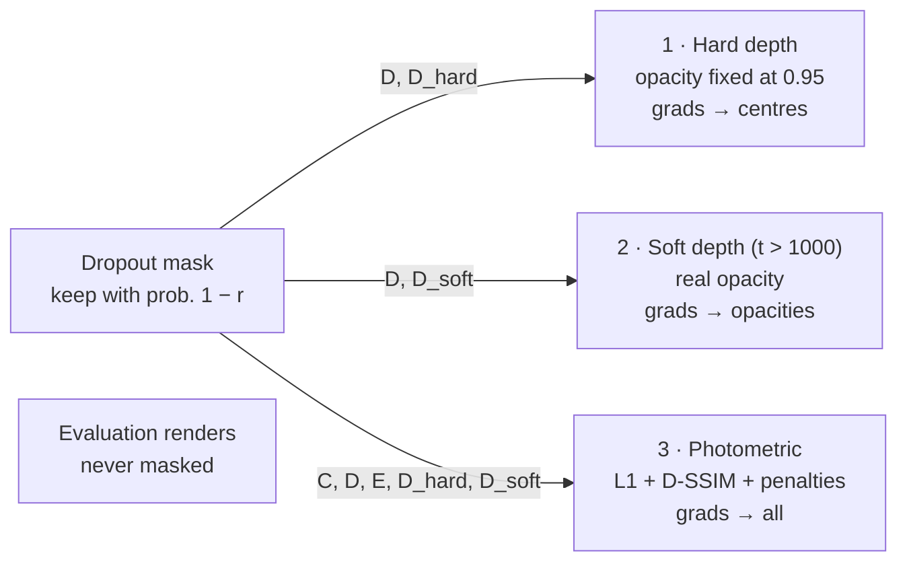

# Do Depth Priors and Gaussian Dropout Add Up in Sparse-View 3D Gaussian Splatting?

**A pre-registered factorial and bias–variance study of DNGaussian's depth prior and DropGaussian's dropout, on LLFF, DTU and Blender (1,169 training runs).**

Aayush Trivedi (2410110012) · Disha Singh (2410110128)
Department of Computer Science and Engineering, Shiv Nadar University, Delhi NCR, India
CSD361 – Introduction to Machine Learning

[](https://github.com/aayxsh23/dngs-dropout/actions/workflows/ci.yml)
[](report/main.pdf)
[](https://aayxsh23.github.io/dngs-dropout/)
[-lightgrey)](LICENSE.md)


*Pixel MSE on held-out views, split into squared bias and run-to-run variance over 3 seeds. Depth (B) mainly removes bias and dropout (C) mainly removes variance; on Blender at 8 views, neither combination beats dropout alone.*

---

## Overview

With 2–3 input photos, 3D Gaussian Splatting overfits: the training views are reproduced and novel views break. Two published regularizers attack this from opposite sides. **DNGaussian** (CVPR 2024) supervises the rendered depth with a monocular prior; **DropGaussian** (CVPR 2025) randomly drops Gaussians during training. We ask whether they are **complementary, redundant or interfering**, and whether it matters if the dropout mask reaches the depth supervision.

Every variant is the same code with different flags. All runs came from git tags, and the analysis rules were tagged before the data they govern existed. The answer is a careful, mostly null result: dropout is a cheap add-on to a depth prior in very sparse scenes, not a synergy.

## Key findings

1. **Complementary on LLFF.** Adding dropout to DNGaussian gains +0.50 to +0.60 dB at 3 views (D − B +0.50 [+0.08, +0.91], E − B +0.60 [+0.30, +0.91]), and the gains add up about additively (I_D +0.02, inconclusive). [`results/tables/paired_3v.md`](results/tables/paired_3v.md)
2. **Never significantly positive across datasets.** Pooled over LLFF, DTU and Blender, E − B is +0.34 dB [+0.04, +0.64] and the interaction I_D is −0.19 dB [−0.37, −0.01]. Verdicts: complementary on LLFF, inconclusive on DTU, partly redundant on Blender. [`results/v2/tables/pooled/verdict_pooled.txt`](results/v2/tables/pooled/verdict_pooled.txt)
3. **Where the mask acts makes no measurable difference.** E − D (mask kept off the depth passes) is ≈ 0 on Blender and pooled (+0.05 [−0.01, +0.12]) and inconclusive on LLFF and DTU. The alpha-clamp and compensation explanations are not supported. [`results/v2/tables/extra/verdict_extra.txt`](results/v2/tables/extra/verdict_extra.txt)
4. **Why: depth removes bias, dropout removes variance,** in the sparsest settings: depth's share of bias reduction is 0.51–0.96 on LLFF 2/3 views and DTU, and dropout's share of variance reduction is 0.74–0.84 on LLFF up to 6 views and Blender. Variance is still 18–34 % of the combinations' error, so the headroom is variance. [`results/v2/tables/error_budget/`](results/v2/tables/error_budget/)
5. **Noise matters.** A single-run 8-scene mean is uncertain by ±0.26 dB (with depth) to ±0.43 dB (without), and the smallest detectable interaction with 8 scenes and 3 seeds is 0.49 dB. [`results/v2/tables/extra/verdict_extra.txt`](results/v2/tables/extra/verdict_extra.txt)

## Method at a glance

DNGaussian runs **three rasterizations per training iteration**, each with its own loss and optimizer step. The dropout mask (each Gaussian kept with probability 1 − r, survivors' opacity × 1/(1 − r), r = γ·t/10000, peak 0.12) can reach any subset of them:



| ID | Depth (`--depth_scale`) | Dropout (`--drop_rate`) | Mask reaches (`--depth_render`) | Role |
| --- | --- | --- | --- | --- |
| A | 0 | 0 | – | 3DGS host without depth |
| B | 1 | 0 | – | DNGaussian as published |
| C | 0 | 0.2 | photometric | DropGaussian alone |
| D | 1 | 0.2 | all three passes (`shared`) | naive combination |
| E | 1 | 0.2 | photometric only (`clean`) | decoupled combination |
| D_hard / D_soft | 1 | 0.2 | photometric + one depth pass | pass localization |

A–D form a 2×2 factorial; the interactions are I_D = (D − C) − (B − A) and I_E = (E − C) − (B − A). Further LLFF blocks vary the dropout dose, the depth weight, the compensation mode (`--drop_mode nc` / `clamp_aware`) and the number of views (2/3/6/9). Details: Sec. III–IV of the paper and [`docs/report/03_method.md`](docs/report/03_method.md).

## Results

PSNR ↑ / SSIM ↑ / LPIPS ↓ on held-out views, mean over 3 seeds. DTU metrics are masked.

| Variant | LLFF, 3 views | DTU, 3 views | Blender, 8 views |
| --- | --- | --- | --- |
| A: none | 16.33 / 0.460 / 0.394 | 14.04 / 0.690 / 0.260 | 23.47 / 0.879 / 0.098 |
| B: depth | 18.71 / 0.592 / 0.302 | 18.37 / 0.776 / 0.176 | 22.66 / 0.868 / 0.112 |
| C: dropout | 16.80 / 0.497 / 0.378 | 14.51 / 0.726 / 0.243 | **23.83 / 0.886 / 0.094** |
| D: both, shared mask | 19.21 / 0.611 / 0.303 | 18.57 / **0.810 / 0.160** | 22.77 / 0.873 / 0.109 |
| E: both, decoupled | **19.31 / 0.617** / 0.303 | **18.67** / 0.807 / 0.163 | 22.82 / 0.874 / 0.108 |

Sources: [`T1/main_3v.md`](results/v2/tables/T1/main_3v.md), [`dtu/main_dtu_3v.md`](results/v2/tables/dtu/main_dtu_3v.md), [`blender/main_blender_8v.md`](results/v2/tables/blender/main_blender_8v.md).

| PSNR contrast, 95 % CI | LLFF | DTU | Blender | Pooled |
| --- | --- | --- | --- | --- |
| B − A (depth) | +2.38 [+1.80, +2.96] | +4.34 [+3.25, +5.42] | −0.80 [−1.78, +0.18] | +1.96 [−0.56, +4.48] |
| C − A (dropout) | +0.48 [+0.18, +0.77] | +0.48 [+0.01, +0.95] | +0.37 [+0.19, +0.55] | +0.40 [+0.28, +0.53] |
| E − B | +0.60 [+0.30, +0.91] | +0.30 [−0.09, +0.68] | +0.15 [+0.02, +0.28] | +0.34 [+0.04, +0.64] |
| E − D | +0.10 [−0.10, +0.30] | +0.09 [−0.24, +0.42] | +0.04 [−0.05, +0.13] | +0.05 [−0.01, +0.12] |
| I_D | +0.02 [−0.34, +0.38] | −0.28 [−0.85, +0.30] | −0.26 [−0.37, −0.15] | −0.19 [−0.37, −0.01] |

Source: [`pooled/verdict_pooled.txt`](results/v2/tables/pooled/verdict_pooled.txt). Full write-ups: [Results v1 (LLFF)](results/RESULTS.md) and [Results v2 (all datasets)](results/v2/RESULTS_v2.md).

<details>
<summary>Number of views (LLFF, 3 seeds)</summary>

| Views | A | B | C | D | E | D − B | I_D |
| --- | --- | --- | --- | --- | --- | --- | --- |
| 2 | 14.30 | 15.76 | 14.83 | 16.21 | 16.44 | +0.45 [+0.24, +0.66] | −0.08 [−0.30, +0.14] |
| 3 | 16.33 | 18.71 | 16.80 | 19.21 | 19.31 | +0.50 [+0.08, +0.91] | +0.02 [−0.34, +0.38] |
| 6 | 20.96 | 21.97 | 21.50 | 22.05 | 22.08 | +0.08 [−0.12, +0.28] | −0.46 [−0.96, +0.04] |
| 9 | 22.85 | 22.64 | 22.91 | 22.60 | 22.55 | −0.04 [−0.18, +0.10] | −0.10 [−0.34, +0.14] |

Sources: [`views/contrasts_3seed.csv`](results/v2/tables/views/contrasts_3seed.csv) and `views/main_*v.md`. The combination's benefit is a very-sparse effect.
</details>

<details>
<summary>More figures</summary>

- [Contrasts per dataset and pooled (forest plot)](results/v2/figures/fig_pooled.png)
- [Error budget vs number of views](results/v2/figures/fig_budget_views.png)
- [Bias floor: MSE(D) vs bias²(B)](results/v2/figures/fig_ceiling.png)
- [Compensation modes](results/v2/figures/fig_comp.png) · [Depth weight](results/v2/figures/fig_depthdose.png) · [Power](results/v2/figures/fig_power.png)
- [LLFF forest plot](results/figures/fig_forest.png) · [Pass localization](results/figures/fig_pass.png) · [Dropout dose](results/figures/fig_dose.png) · [Test-time robustness](results/figures/fig_robustness.png) · [Qualitative](results/figures/fig_qual.png)
</details>

## Quickstart

```bash
git clone https://github.com/aayxsh23/dngs-dropout.git && cd dngs-dropout
bash scripts/check.sh            # CPU-only checks, seconds; no data needed
```

Training needs Python 3.7, PyTorch 1.12.1 and CUDA 11.3, with the vendored extensions built for your GPU: see [`setup_env.sh`](setup_env.sh) and the full package list in [`pip_freeze_laptop.txt`](pip_freeze_laptop.txt). Put LLFF with DPT depth in `data/llff/` (sources and md5s are in [`docs/REPRODUCE.md`](docs/REPRODUCE.md)), then run a short smoke test of every variant:

```bash
bash scripts/gpu_smoke.sh        # 1100 iterations on fern per variant, 1.5–7 min
```

## Reproduce the paper

| Dataset | Tag | Matrix | Runs | Data archive md5 |
| --- | --- | --- | --- | --- |
| LLFF (T1, P, G, N, V) | `v1.0-exp` | `experiments/matrix{,_pass,_dose,_noise,_views}.yaml` | 120 + 48 + 48 + 8 + 360 | `0f6bd7bdae837ec58ad757c7c00b0561` |
| LLFF (COMP, DDOSE, NOISE2) | `v1.1-exp` | `experiments/matrix_{comp,depthdose,noise2}.yaml` | 96 + 96 + 48 | same |
| DTU | `v1.2-exp` | `experiments/matrix_dtu.yaml` | 225 | `dc8df470e9cf6e46cd024cb34d19c175` |
| Blender | `v1.2-exp` | `experiments/matrix_blender.yaml` | 120 | `e7597085f8682b660699a39f63d5957f` |

```bash
git checkout v1.0-exp
python experiments/run_matrix.py --matrix experiments/matrix.yaml --data_root data/llff --out_root outputs \
    --shard 0/1 --seeds 0 1 2 --dry_run        # prints "120 of 120 runs"; drop --dry_run to train
```

Each run trains for 6000 iterations (about 84–145 s on an RTX A4000), renders the held-out views and writes its metrics. Tables, statistics and figures then regenerate on a CPU from the committed per-run results. **The full guide, with data preparation (COLMAP, DPT) and every command, is [`docs/REPRODUCE.md`](docs/REPRODUCE.md).**

## Repository map

```text
train_llff.py, train_dtu.py, train_blender.py   training; dropout behind --drop_rate, --depth_render, --drop_mode
gaussian_renderer/                             renderers; the optional drop_comp vector is the ported DropGaussian line
utils/dropout.py                               clamp-aware and no-compensation dropout (our extensions)
render.py, metrics.py, experiments/eval_dtu.py evaluation (never masked)
experiments/run_matrix.py, matrix*.yaml        tag-gated experiment runner and the frozen experiment blocks
experiments/{aggregate,stats,bias_variance,extra_blocks,interaction_scales,views_contrasts}.py   analysis
experiments/{geometry,probes}.py               MVC@5% geometry and test-time probes (need checkpoints)
experiments/plots/                             figure scripts
results/                                       committed per-run results, tables, figures, write-ups (v1, v2)
report/                                        the paper: LaTeX, references, number trace, compliance table
docs/                                          plan, pre-registration (PLAN_V2 §5), report drafts, REPRODUCE, ATTRIBUTION
scripts/                                       check.sh, gpu_smoke.sh, run scripts, merge gate, submission zip
notebooks/                                     Colab runner and the results-v2 analysis notebook
dpt/, gridencoder/, shencoder/, submodules/    upstream depth scripts and vendored CUDA extensions
```

## Engineering and reproducibility

- **Tag-gated runs.** `run_matrix.py` refuses to run from anything but a clean tag (`v1.0-exp`, `v1.1-exp`, `v1.2-exp`). Each run's `config.json` records the commit, and its `metrics.json` the GPU and whether it was shared.
- **Pre-registration.** Decision rules, margins and hypotheses were tagged before the data they govern: `prereg-v1` (LLFF), `prereg-v2` (compensation) and `prereg-v3` (DTU, Blender, error budget). `prereg-v3` was written after the LLFF results were seen, and says so. See [`docs/PLAN_V2.md`](docs/PLAN_V2.md) §5.
- **Frozen data.** One depth archive per dataset, checked by md5 on every machine.
- **CI.** [`scripts/check.sh`](scripts/check.sh) checks the verbatim DropGaussian port, the no-mask evaluation paths, Python 3.7 compatibility, the analysis on fixtures and the runner end to end. Merges to `main` go through CI and an independent review ([`AGENTS.md`](AGENTS.md)).
- **Run log.** Every machine event, rerun decision and checksum is in [`RUNLOG.md`](RUNLOG.md). A CPU regeneration of all tables matches the committed ones ([`docs/REPRODUCE.md`](docs/REPRODUCE.md) §3).

## Limitations

- **Power.** With 8 scenes and 3 seeds, interactions below about 0.5 dB cannot be detected per dataset. "Inconclusive" means "not shown", not "absent".
- **Nondeterminism.** The rasterizer's backward pass is not deterministic, and the same seed varies as much as a new seed.
- **One dose and one protocol.** DropGaussian's schedule is kept verbatim (peak rate 0.12). Blender uses one setting for all objects, so DNGaussian is not tuned per object there.
- **Shared GPU.** Only the first blocks ran on an unshared GPU, so efficiency numbers come from LLFF T1 only.
- **Post hoc elements.** `prereg-v3` came after the LLFF results, and its variance-component check is circular, so the power numbers are planning figures.

## Citation

```bibtex
@misc{trivedi2026depthdropout,
  author       = {Trivedi, Aayush and Singh, Disha},
  title        = {Do Depth Priors and Gaussian Dropout Add Up in Sparse-View {3D} {G}aussian Splatting?
                  {A} Pre-Registered Factorial and Bias--Variance Study},
  howpublished = {CSD361 course project, Shiv Nadar University},
  year         = {2026},
  url          = {https://github.com/aayxsh23/dngs-dropout}
}

@inproceedings{li2024dngaussian,
  author    = {Li, Jiahe and Zhang, Jiawei and Bai, Xiao and Zheng, Jin and Ning, Xin and Zhou, Jun and Gu, Lin},
  title     = {{DNGaussian}: Optimizing Sparse-View {3D} {G}aussian Radiance Fields with Global-Local Depth Normalization},
  booktitle = {Proc. IEEE/CVF Conf. Computer Vision and Pattern Recognition (CVPR)},
  year      = {2024}
}

@inproceedings{park2025dropgaussian,
  author    = {Park, Hyunwoo and Ryu, Gun and Kim, Wonjun},
  title     = {{DropGaussian}: Structural Regularization for Sparse-view {G}aussian Splatting},
  booktitle = {Proc. IEEE/CVF Conf. Computer Vision and Pattern Recognition (CVPR)},
  pages     = {21600--21609},
  year      = {2025}
}
```

## Team and contributions

| | Aayush Trivedi | Disha Singh |
| --- | --- | --- |
| Code | dropout port and mask routing, compensation modes, DTU and Blender port, runner and matrices, CI and review gate | Colab runner, aggregation and statistics, error budget, pooled analysis, plots |
| Data and runs | DTU preparation (COLMAP, DPT), laptop reproduction, lab runs | LLFF and Blender depth archives, Colab reproduction, lab runs |
| Writing | research analysis and plan, method and setup, paper | pre-registration v3, results v1 and v2, results and discussion, website |

Per-file authorship from the commit history: [`docs/ATTRIBUTION.md`](docs/ATTRIBUTION.md).

## Acknowledgments and license

We thank the CSD361 course staff, the lab that provided the GPU, and the authors of [DNGaussian](https://github.com/Fictionarry/DNGaussian) and [DropGaussian](https://github.com/DCVL-3D/DropGaussian_release) for releasing their code.

This repository is a fork of DNGaussian, which builds on 3D Gaussian Splatting. It keeps their licence, the Gaussian-Splatting License (non-commercial research use), in [`LICENSE.md`](LICENSE.md). Only DropGaussian's two dropout lines are ported; see [`docs/ATTRIBUTION.md`](docs/ATTRIBUTION.md). The original DNGaussian README is in [`docs/UPSTREAM_README.md`](docs/UPSTREAM_README.md).
